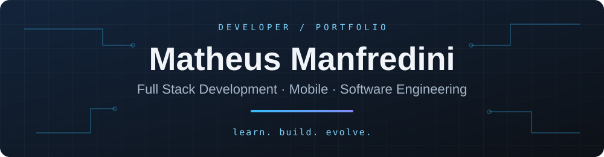

  

  
  
  

## 01. Sobre mim

Estudante de **Análise e Desenvolvimento de Sistemas no Instituto Federal de São Paulo (IFSP)**, com foco no desenvolvimento de aplicações web e mobile, construção de APIs e soluções para problemas reais.

Busco evoluir constantemente em arquitetura de software, segurança e experiência do usuário.

## 02. Tech Stack

Tecnologias com as quais tenho experiência prática ou que venho estudando:

**Front-end**

**Back-end & Mobile**

**Banco de dados & Ferramentas**

## 03. Projetos em destaque

| Projeto | Descrição | Tecnologias |
| :--- | :--- | :--- |
| [Assinatura Digital](https://github.com/matheusmanfredinii/assinatura-digital) | Demonstração acadêmica de captura de assinaturas manuscritas em dispositivo móvel, com validação de traços e exportação de dados. | React Native, Expo, WebView |
| [Biblioteca Camugerê](https://github.com/adsifspcaragua/Camugere) | Sistema Full Stack de gestão da biblioteca comunitária do Espaço Cultural Casa da Democracia, com gerenciamento de acervo, leitores, empréstimos, devoluções, relatórios, notificações e backups automatizados. | React, Vite, Tailwind CSS, Node.js, Express, Prisma, MySQL, Zod, JWT |

## 04. GitHub Activity

  

  <a href="https://github.com/matheusmanfredinii?tab=overview">Ver minha atividade e contribuições no GitHub</a>

---

<em>Transformando conhecimento em soluções através da tecnologia.</em>

